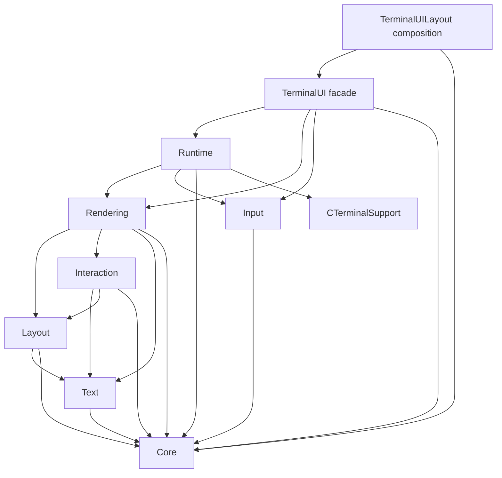

TerminalUI uses separate SwiftPM targets to enforce dependency direction. The `TerminalUI` product remains the consumer entry point; its module contains explicit public aliases for the types owned by the implementation modules. `TerminalUIChroma` remains an optional adapter.

| Target | Responsibility | Direct dependencies |
| --- | --- | --- |
| `TerminalUICore` | Element model, actions and events, styles, canvas/grid, display width, geometry values and custom-widget contracts. Includes the small self-contained tab/menu widgets used by element factories. | None |
| `TerminalUIText` | Wrapping, bounded text-layout caching, text metrics and editor coordinates. | Core |
| `TerminalUIInput` | Incremental keyboard, paste and mouse packet decoding. | Core |
| `TerminalUILayoutEngine` | Retained nodes, measurement, allocation, mouse geometry and node-to-text-cache adaptation. | Core, Text |
| `TerminalUIInteraction` | Keyboard/pointer routing, shortcuts, transient state, editing, collection navigation, focus and tree-query policies. | Core, Text, Layout |
| `TerminalUIRendering` | Engine composition, built-in painters, retained repainting, frame differencing and ANSI style encoding. | Core, Text, Layout, Interaction |
| `TerminalUIRuntime` | Application host, escape deadlines, frame transmission and native terminal session lifecycle. | Core, Input, Rendering, CTerminalSupport |
| `TerminalUI` | Consumer facade with explicit aliases for the existing public names. | Core, Input, Rendering, Runtime |
| `TerminalUILayout` | Optional builder API, component factories and negotiated stack strategies. | TerminalUI, Core |
| `TerminalUIChroma` | Optional Chroma-to-semantic-text adapter. | TerminalUI, Chroma |

The manifest lists all direct dependencies explicitly. No implementation target imports the facade, and the core does not depend on any implementation target. The existing `TerminalUI` and `TerminalUIChroma` library products are retained; the implementation targets are not additional published products. The optional `TerminalUILayout` product adds negotiated composition; its implementation is separate from the internal `TerminalUILayoutEngine` target.

`UIEngine` is the composition root and public coordinator. Its renderer, keyboard router, pointer router, focus manager and state store are private collaborators. Rendering and input behaviour no longer live in engine extensions. Components receive specific services through initializers and never receive a reference back to the engine.

| Component | State and responsibility |
| --- | --- |
| `FrameRenderer` | Owns the retained tree/frame, pending repaint boundary, reveal request, clipping transforms and geometry lifetime. Receives measurement, allocation, text-layout and built-in painter instances. Each frame receives an immutable theme/focus environment. |
| `KeyboardRouter` | Applies shortcut precedence, focus traversal, focused bindings and control dispatch through injected shortcut, editor and collection services. A viewport repaint is permitted only when focus stays unchanged, including initial focus acquisition. |
| `PointerRouter` | Owns press/release identity and resize cancellation. Receives a current geometry view plus theme for each synchronous dispatch, and shares the injected focus and widget-state services. |
| `FocusManager` | Owns current focus, modal restoration and successor selection. The engine exposes a read-only public getter. |
| `WidgetStateStore` | Owns editor/viewport records and manual-scroll flags, including reset and bounded inactive retention. Application text, selected rows and business actions remain application-owned. |

Routers return `InteractionOutcome`: unchanged, viewport repaint for an ID, or rebuild with an optional action. The engine applies these results to the renderer and returns the existing public `UIEventResult`. Routers cannot mutate renderer state.

`RenderedGeometry` is a package-only, expiring view of the painted tree. The renderer expires the old view before reconciling nodes, repainting or applying geometry-changing invalidation. Captured views then expose no root, even after the same retained nodes are painted again. Pointer routing borrows a view for one synchronous event and never retains it. Press identity is stored separately so a matching release can survive an ordinary view rebuild when dispatched against fresh geometry; resize, explicit focus/reset and keyboard input cancel that identity.

`TerminalHost` coordinates the engine, decoder and session. It requests mouse-geometry preparation through an engine method, without inspecting rendering flags. Frame transmission receives an async transport closure, and escape timing receives a clock.

Shared implementation contracts use Swift `package` access. They cross target boundaries without becoming public consumer API. Other details remain `internal` or `private`. The host can update/repaint the retained tree and request current input geometry, but it cannot access the engine's widget state, renderer or painter instances. The core's element representation remains opaque to consumers.

`EditorCoordinates` supplies the same mapping to keyboard navigation, drawing and mouse placement.

Tree traversal policies deliberately differ. Focus ignores disabled subtrees and follows only the top of an overlay; modal discovery searches visible children in reverse order; state retention includes both overlay branches. Structural child access and control identity are package-only core properties.

The layout adapter owns weak node-to-entry reuse. The text cache has no dependency on retained nodes. Changes to a node's measurement inputs invalidate its reusable entry; styles remain draw-time inputs. Plain and styled wrapping retain their existing whitespace policies.

Scroll composition, clipping, mouse geometry and targeted repaint boundaries are owned by `FrameRenderer` in Rendering. A scroll repaint must preserve ancestor backgrounds, repaint enclosing overlays as necessary, and leave unrelated widgets untouched. Widget painters update the viewport and mouse geometry associated with their own node.

All extracted services use instance composition. Existing public factories/constants and the host's process-wide active-session guard retain their behaviour. The guard protects process-wide terminal attributes and signal ownership.

The [module migration review](Module-Migration-Review.md) records the nominal type ownership changes and compatibility checks. Run `swift test` for all tests, including captured-geometry expiry and press/release continuity through a rebuilt view. Input, interaction and runtime-policy tests also have their own test targets; mixed engine/host tests remain in `TerminalUITests`. `TerminalUICompatibilityTests` depends only on the facade and uses ordinary imports. After building the demo, run `python3 Scripts/test-terminalui-pty.py` for terminal lifecycle and integration checks.

Negotiated layout uses a Core-owned `ElementLayout` container contract. The optional composition module supplies strategies; the renderer measures and places ordinary element children through that contract, preserving their focus, pointer, modal and retained-scroll behavior. Existing array-based stacks keep their original allocator. See [negotiated layout](Negotiated-Layout.md) for the public API and sizing semantics.

The [component and state architecture migration plan](Specs/TerminalUI/Component-State-Architecture-Plan.md) describes the proposed next layer: struct components, persistent identity-based state, bindings, scheduled transactions and selective component rebuilding. It is a future implementation plan; the architecture above describes the current implementation.
