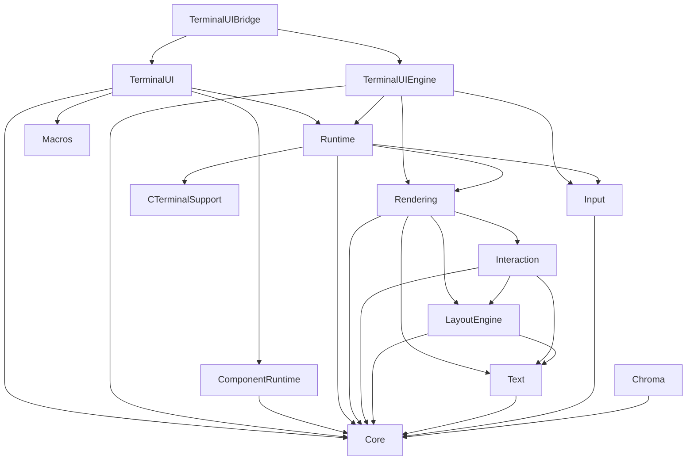

# Architecture

`TerminalUI` owns the high-level declarative API. `TerminalUIEngine` owns the low-level facade. Neither depends on the other or re-exports implementation modules. `TerminalUIBridge` is an explicit opt-in target depending on both; engine-only consumers avoid high-level and macro compilation. `TerminalUIChroma` depends directly on shared semantic text models in Core.

| Target | Responsibility | Direct dependencies |
| --- | --- | --- |
| `TerminalUICore` | Elements, shared developer models, drawing contracts, composition addresses, negotiated stack strategy and opaque handles. | None |
| `TerminalUIText` | Wrapping, text metrics, editor coordinates and bounded text cache. | Core |
| `TerminalUIInput` | Incremental keyboard, paste and mouse decoding. | Core |
| `TerminalUILayoutEngine` | Retained nodes, measurements, allocation and geometry. | Core, Text |
| `TerminalUIInteraction` | Keyboard/pointer routing, focus, widget mechanics and tree queries. | Core, Text, Layout |
| `TerminalUIRendering` | Rendering composition, painters, frames and encoding. | Core, Text, Layout, Interaction |
| `TerminalUIRuntime` | Host, presentation services, wakeups and terminal lifecycle. | Core, Input, Rendering, CTerminalSupport |
| `TerminalUIComponentRuntime` | Mount identity, state slots, dependencies, scopes and scheduling. | Core |
| `TerminalUI` | Public typed views, builders, modifiers, macros, runner and harness. | Core, Runtime, ComponentRuntime, ComponentMacros |
| `TerminalUIEngine` | Raw facade, legacy element builder and factories. | Core, Input, Rendering, Runtime |
| `TerminalUIBridge` | Raw content in views and views as engine presentations. | TerminalUI, TerminalUIEngine, Core |
| `TerminalUIComponentMacros` / `TerminalUIComponentMacroSupport` | Compiler plugin, application entry/conformance/isolation and state registration. | SwiftSyntax and compiler plugin tooling |
| `TerminalUIChroma` | Syntax tokens converted to semantic spans. | Core, Chroma |

`TerminalView` has an associated body; parameter-pack tuples, optionals, branches and repetition retain concrete composition types. Package-only primitive lowering runs inside the installed owner's dependency-recording and mutation-restriction scope. It emits unevaluated descriptors for user children. Structural addresses reach mounted matching before layout children are flattened. Identity wrappers reset their entire subtree; scope wrappers provide generation-scoped lookup without resetting state when a scope name changes. The renderer sees resolved elements and revision boundaries only.

Public aliases are curated. The runner's host and presentation remain package-only; `ApplicationHarness` returns snapshots and accepts high-level input rather than raw elements or presentation services. External compilation fixtures and public symbol inspection enforce the boundary. See the [migration guide](High-Level-API-Migration.md) and [implementation plan](Specs/TerminalUI/High-Level-API-Architecture-Plan.md).

`UIEngine` is the composition root and public coordinator. Its renderer, keyboard router, pointer router, focus manager and state store are private collaborators. Rendering and input behaviour no longer live in engine extensions. Components receive specific services through initializers and never receive a reference back to the engine.

| Component | State and responsibility |
| --- | --- |
| `FrameRenderer` | Owns the retained tree/frame, pending repaint boundary, reveal request, clipping transforms and geometry lifetime. Receives measurement, allocation, text-layout and built-in painter instances. Each frame receives an immutable theme/focus environment. |
| `KeyboardRouter` | Applies shortcut precedence, focus traversal, focused bindings and control dispatch through injected shortcut, editor and collection services. A viewport repaint is permitted only when focus stays unchanged, including initial focus acquisition. |
| `PointerRouter` | Owns press/release identity and resize cancellation. Receives a current geometry view plus theme for each synchronous dispatch, and shares the injected focus and widget-state services. |
| `FocusManager` | Owns current focus, modal restoration and successor selection. The engine exposes a read-only public getter. |
| `WidgetStateStore` | Owns editor/viewport records and manual-scroll flags, including reset and bounded inactive retention. Application text, selected rows and business actions remain application-owned. |

Routers return `InteractionOutcome`: unchanged, viewport repaint for an ID, or rebuild with an optional action. The engine applies these results to the renderer and returns the existing public `UIEventResult`. Routers cannot mutate renderer state.

`RenderedGeometry` is a package-only, expiring view of the painted tree. The renderer expires the old view before reconciling nodes, repainting or applying geometry-changing invalidation. Captured views then expose no root, even after the same retained nodes are painted again. Pointer routing borrows a view for one synchronous event and never retains it. Press identity is stored separately so a matching release can survive an ordinary view rebuild when dispatched against fresh geometry; resize, explicit focus/reset and keyboard input cancel that identity.

`TerminalHost` coordinates the engine, decoder and session. It requests mouse-geometry preparation through an engine method, without inspecting rendering flags. Frame transmission receives an async transport closure, and escape timing receives a clock.

Shared implementation contracts use Swift `package` access. They cross target boundaries without becoming public consumer API. Other details remain `internal` or `private`. The host can update/repaint the retained tree and request current input geometry, but it cannot access the engine's widget state, renderer or painter instances. The core's element representation remains opaque to consumers.

`EditorCoordinates` supplies the same mapping to keyboard navigation, drawing and mouse placement.

Tree traversal policies deliberately differ. Focus ignores disabled subtrees and follows only the top of an overlay; modal discovery searches visible children in reverse order; state retention includes both overlay branches. Structural child access and control identity are package-only core properties.

The layout adapter owns weak node-to-entry reuse. The text cache has no dependency on retained nodes. Changes to a node's measurement inputs invalidate its reusable entry; styles remain draw-time inputs. Plain and styled wrapping retain their existing whitespace policies.

Scroll composition, clipping, mouse geometry and targeted repaint boundaries are owned by `FrameRenderer` in Rendering. A scroll repaint must preserve ancestor backgrounds, repaint enclosing overlays as necessary, and leave unrelated widgets untouched. Widget painters update the viewport and mouse geometry associated with their own node.

All extracted services use instance composition. Existing public factories/constants and the host's process-wide active-session guard retain their behaviour. The guard protects process-wide terminal attributes and signal ownership.

The [module migration review](Module-Migration-Review.md) records the nominal type ownership changes and compatibility checks. Run `swift test` for all tests, including captured-geometry expiry and press/release continuity through a rebuilt view. Input, interaction and runtime-policy tests also have their own test targets; mixed engine/host tests remain in `TerminalUITests`. `TerminalUICompatibilityTests` depends only on the facade and uses ordinary imports. After building the demo, run `python3 Scripts/test-terminalui-pty.py` for terminal lifecycle and integration checks.

Negotiated layout uses a Core-owned `ElementLayout` container contract. Core supplies the shared negotiated stack strategy; the engine supports custom strategies; the renderer measures and places ordinary element children through that contract, preserving their focus, pointer, modal and retained-scroll behavior. Existing array-based stacks keep their original allocator. See [negotiated layout](Negotiated-Layout.md) for the public API and sizing semantics.

The mounted component layer is implemented. Core owns the presentation source and opaque descriptor/boundary contracts; the host consumes those contracts without depending on `TerminalUI`. Resolved boundaries are transparent to focus, mouse, modal discovery, measurement and painting. Layout nodes match keyed boundaries by generation identity and skip unchanged subtree revisions.

`TerminalUIComponentRuntime` owns mount-local state and state-read subscriptions separately from `WidgetStateStore`. It updates cached output paths after child-only changes, replaces callbacks with fresh body captures, and schedules coalesced main-actor wakeups. A dedicated application-update pipe is observed by Linux polling and the Darwin select helper. Input consistency barriers precede subsequent dispatch; terminal output receives immutable snapshots. Teardown joins the input read before closing descriptors.

See [components and mounted state](Components.md) for the public API, mixed migration, scoped focus, transactions, the LayoutDemo view model and validation. The [architecture migration plan](Specs/TerminalUI/Component-State-Architecture-Plan.md) records the design and delivery criteria.
