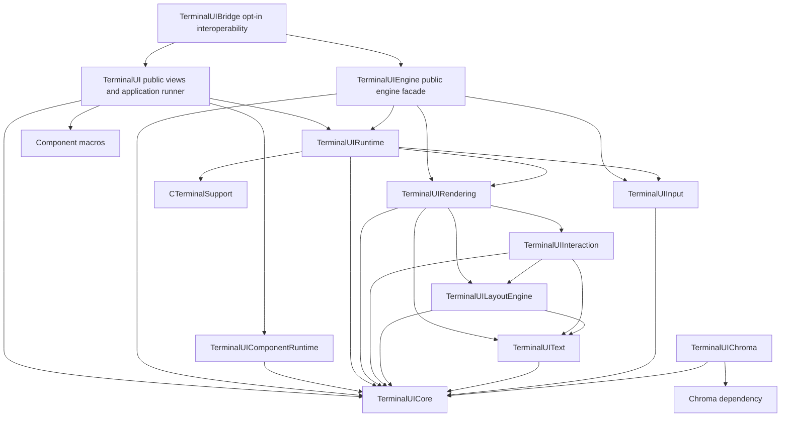

# High-level TerminalUI API and engine boundary

Status: implemented breaking migration. Implementation decisions and validation are recorded below.

This is a breaking migration. It supersedes the public module, fixed `body: Element`, flattened-builder and conditional-identity decisions in the implemented [component and state architecture plan](Component-State-Architecture-Plan.md). The existing mounted state, scheduling, rendering and terminal lifecycle behavior remains the implementation foundation.

## Intended outcome

Developers build applications with `import TerminalUI`. It provides declarative applications, composable views, opaque view bodies, state, bindings, layout, styling and application services. Engine APIs require an explicit `import TerminalUIEngine`.

The public view API preserves concrete composition types while allowing developers to write `some TerminalView`. Internal lowering converts those values into the existing element representation during mounted evaluation. Raw elements and terminal machinery do not appear in ordinary application signatures.

This migration establishes the public composition model now, avoiding a subsequent migration from `Element` to a fixed wrapper and then to associated view bodies. It does not depend on proving a rendering performance improvement. Generic specialization is an optimization opportunity, not an acceptance criterion.

## Architecture before migration

The migration started from this public dependency chain:

```text
TerminalUIComponents -> TerminalUILayout -> TerminalUI -> implementation targets
```

- `TerminalUI` is a low-level facade containing explicit type aliases; implementations already belong to Core, Input, Rendering and Runtime.
- `TerminalUILayout` depends on and re-exports that facade. Its builder flattens content into `[Element]`.
- `TerminalUIComponents` re-exports Layout. Its `TerminalView` requires `body: Element`.
- The application root, component descriptors, state and bindings already use generics. The composed body itself has a uniform element representation.
- Mounted component identity combines its mounted owner, component type, and an explicit key or structural element path. Conditional branch identity is lost when builder content is flattened.
- `TerminalApp.host`, `TerminalApp.presentation` and the public presentation harness expose engine integration through the high-level API.

Adding a component dependency to today's `TerminalUI` target would create a cycle. Renaming products or re-exporting Components would also retain the existing API leaks.

## Public products and dependency direction

| Product/module | Public responsibility |
| --- | --- |
| `TerminalUI` | Declarative applications; `TerminalView`; view builder; controls and containers; modifiers; state and bindings; application context; high-level run, preview and test APIs. |
| `TerminalUIEngine` | Raw `Element` construction, legacy applications, presentation-source integration, `UIEngine`, `TerminalHost`, input decoding, frame encoding, canvas/grid drawing and custom-widget contracts. |
| `TerminalUIChroma` | Optional syntax-highlighting adapter returning semantic text spans usable by either API. |
| `TerminalUIBridge` | Opt-in embedding of raw engine content and hosting high-level roots from engine code. |

Remove the `TerminalUIComponents` and `TerminalUILayout` products and imports in the breaking release. Public view, control and builder declarations should be owned by `TerminalUI`; implementation code can remain divided into files and internal targets where that enforces useful boundaries.



The diagram includes the selected opt-in bridge. Neither public facade depends on the other. Lower implementation targets must not import either facade. The high-level runner uses the implementation runtime directly, without re-exporting it.

Retain the existing internal targets unless a concrete dependency or ownership issue requires changing them. Move the current low-level aliases into `TerminalUIEngine`; preserve their underlying nominal owners where practical. Chroma should depend directly on the text models in Core rather than on either public facade.

### Public API boundary

Select exports explicitly. Do not re-export Core, Runtime, Rendering, Input, the engine facade, or the old facade transitively through another module.

Shared developer-facing models such as `Theme`, color/style values, sizing preferences, insets, row/column/menu models, configuration, relevant actions/events and opaque focus handles may be exposed through selected aliases or dedicated public values. A type's implementation module alone does not make it unsuitable for the high-level API; its complete public surface must be appropriate for application developers.

Exclude raw `Element`, `UIEngine`, `TerminalHost`, `InputDecoder`, `FrameEncoder`, `Canvas`, `CellGrid`, custom-widget measurement/drawing contexts and raw presentation contracts from the high-level surface. An alias to `Element` is insufficient because all of its public members remain available.

Audit members and inferred return types as well as imported names. A public `host` property would expose engine operations even if the `TerminalHost` name were absent from ordinary lookup.

This is a supported API and import boundary. Implementation modules remain compiled dependencies; the package is not trying to make its implementation inaccessible to deliberately imported modules.

## Generic view composition

The intended application spelling is:

```swift
import TerminalUI

@main
@TerminalApplication
struct NotesApp {
    var root: some TerminalView { Workspace() }
}

@TerminalComponent
struct Workspace: TerminalView {
    @State private var draft = ""

    var body: some TerminalView {
        Column(spacing: 1) {
            Text("Notes").role(.heading)
            Panel("Command") {
                TextEditor(id: "draft", text: $draft)
                    .onSubmit { draft = "" }
            }
            .height(.fit(maximum: 8))
        }
    }
}
```

Examples in this plan specify the intended API, not code that compiles against the current package.

The essential protocol shape is:

```swift
@MainActor
public protocol TerminalView {
    associatedtype Body: TerminalView
    @ViewBuilder var body: Body { get }
    // Macro installation support is retained separately.
}
```

`some TerminalView` hides a specific concrete return type; it does not erase all views to `any TerminalView`. Application roots already use an associated root type and should retain that behavior.

- Controls become concrete view values. Containers such as `Column<Content>` and `Panel<Content>` retain their content's type.
- Modifiers produce typed compositions around their content. Styling and layout modifiers retain identity when their parameter values change; they must not create arbitrary new state owners on each evaluation.
- The builder preserves fixed child slots, conditional branches, optional content, and repetition boundaries. It must not flatten them into element arrays before identity has been captured.
- Use generic builder composition, with parameter packs if suitable for the supported compiler, rather than a fixed maximum child count. Variadic syntax and public helper names are implementation details to settle in the composition prototype.
- `ForEach` retains its collection scope and stable item keys. Also support ordinary builder loops with documented positional identity, or provide an explicit migration to `ForEach`; never silently present positional matching as keyed matching.
- Keep type erasure inside runtime descriptors or at deliberate heterogeneous-storage boundaries. A universal erased return value must not replace the associated `Body` model.

Primitive views need a terminal lowering implementation rather than recursively evaluating `body`. Prototype a `Body == Never` leaf convention with an internal/package primitive-lowering contract. Primitive `body` access must not occur during normal resolution. The public `TerminalView` contract must not require application authors to return raw elements or implement engine rendering hooks.

External macro expansions need access to installation support. Keep the minimum required support types and underscored members publicly callable with opaque contents; do not expose mount records, slots or raw elements through their signatures. Document these as compiler support rather than normal application operations.

## Lowering and mounted evaluation

```text
typed public view values
    -> unevaluated component descriptors with structural identity metadata
    -> mounted evaluation, state installation and dependency tracking
    -> resolved Element tree and revision boundaries
    -> existing layout, rendering, interaction and terminal runtime
```

Lowering is internal representation conversion, not a second state or rendering system.

1. Constructing an application or composing a child must not eagerly evaluate arbitrary component bodies or read uninstalled state.
2. Install a component's persistent properties before evaluating its body. Evaluate that body inside its existing dependency-recording scope.
3. Preserve the distinction between user component boundaries and primitive/composition implementation nodes. State ownership and selective invalidation must follow documented component identities.
4. Carry structural paths, branch discriminators, collection scopes and item keys into mounted matching before flattening any children for layout. Runtime metadata can preserve this information even after generic types are erased internally.
5. Do not recursively evaluate a child component while recording the parent's dependencies. Preserve deferred child descriptors so child-only reads and writes stay associated with the child.
6. Refresh inputs and callback captures for a matched component while retaining its state slots. Preserve subtree revisions, retained layout reuse and generation-scoped control IDs.
7. Keep renderer and host consumption limited to resolved elements. They do not inspect generic public bodies or evaluate user view code.

Binding reads used to configure controls must occur in the appropriate mounted evaluation scope. The prototype must verify that deferring work in typed primitives neither reads state before installation nor moves reads outside the owning component's dependency tracking.

This is a phase-1 gate: keep primitive lowering within the installed component's dependency-recording and mutation-restriction scope, while leaving child component bodies deferred. Demonstrate a bound primitive updating, switching dynamic subscriptions, and preserving parent/sibling evaluation counts before porting the remaining controls.

## Identity and lifetime contract

Opaque types preserve useful structure, but identity is a runtime matching contract. The implementation must retain that structure through lowering.

Conceptually, identity is the mounted parent's identity plus a local structural/explicit address and the concrete component type. Each new mount also receives a generation. This is a semantic contract, not a promise to reproduce SwiftUI's private implementation.

| Situation | Required behavior |
| --- | --- |
| Same type at the same structural location, new input values | Preserve local state; refresh inputs and callbacks. |
| Two same-type children at different fixed child slots | Independent identities and state. |
| Same-type components in different conditional branches | Distinct identities. Switching branches unmounts the previous branch. |
| Optional child disappears and returns | New generation and initial state on return. |
| Optional earlier sibling appears/disappears | Preserve the structural slots of later fixed siblings. |
| Keyed item reorders within the same repetition scope | Preserve mounted state and retained widget identity. |
| Item key or component type changes | Replace the affected identity and subtree. |
| Duplicate item keys in one repetition scope | Diagnose invalid content; never merge state. |
| Equal item keys in independent repetition scopes | Independent identities. |
| Component moves to a different mounted parent or collection scope | New identity; keys are not global reparenting handles. |
| Present component is hidden with `.visible(false)` | Retain its mounted state. |
| Component is removed | Unmount; release state/subscriptions/callbacks. Reappearance creates a new generation. |
| Identity modifier's value changes | Reset the modified subtree, including descendants' local state and scoped handles. |
| Programmatic reveal/scroll targets a stable explicit ID | Locate and reveal the current mounted view without changing its identity or local state. |
| Layout/style/focus/selection values change | Preserve identity unless an explicit identity boundary changes. |

Branch identity must survive even when both branches have the same concrete type:

```swift
if editing {
    CommandPane(mode: .editing)
} else {
    CommandPane(mode: .preview)
}
```

Those panes have separate lifetimes. Expressing one pane with changing input preserves its lifetime instead:

```swift
CommandPane(mode: editing ? .editing : .preview)
```

Implement the high-level `.id(_:)` modifier as explicit subtree identity and as the identifier used by programmatic scroll/reveal services, aligning with SwiftUI's use of `.id(_:)` for both purposes. Accept stable `Hashable` values rather than restricting IDs to strings. Keeping an ID stable preserves identity when the surrounding structure is compatible; changing it resets the modified subtree even when the ID was originally added to support scrolling. Requesting a scroll/reveal does not itself reset identity or state.

```swift
Text("Summary")
    .id("summary")
```

The view above has explicit identity and can be located by its ID through a high-level scoped scroll/reveal service. That service must be usable without exposing a host, raw element or renderer. ID lookup must respect the containing mounted/scroll scope; matching IDs in unrelated components are not global addresses. Preserve typed ID equality through lowering and use collision-free internal engine addresses rather than deriving identity from a display string.

Lookup starts at an explicitly selected mounted scope and searches its current descendants. A nested scroll container does not hide targets: revealing a target asks its enclosing scroll containers to reveal it. An absent or hidden target returns failure without retaining a request for a later mount. Duplicate target IDs within the selected lookup scope are ambiguous: diagnose and return failure rather than selecting the first match. Callers can narrow the scope to disambiguate equal IDs in independent collections/components.

Focus and reveal addressing must distinguish independent repetition scopes containing equal item keys. Preserve convenient key-path lookup where unambiguous, but diagnose ambiguous paths instead of choosing a child arbitrarily. Provide opaque generation-scoped handles and scoped lookup; handles from a removed or reset subtree must not resolve against its replacement. Resolve these service contracts, including scope selection, in phase 1 rather than treating them as naming-only decisions.

The existing raw `Element.id(_:)` remains a reveal-only identifier in `TerminalUIEngine`. Document this semantic difference prominently. Control `id:` arguments and opaque focus handles remain separate concepts; adding an explicit view ID must not silently turn it into a control ID. Defer a separate high-level `.revealID(_:)` modifier until a concrete use case requires reveal targeting independent of identity.

An explicit ID does not cancel conditional-branch or parent scope. Identical IDs in different branches must not revive or transfer state between branches. Avoid generating fresh random IDs during every body evaluation; identity follows stable structure or application data.

Generation checks must continue preventing detached bindings, callbacks and focus handles from targeting a replacement mount. Component state lifetime remains separate from the bounded inactive retention of widget mechanics such as caret and viewport state.

## Application services and engine interoperability

Keep `@main @TerminalApplication`, `TerminalApplicationDefinition`, `TerminalApp`, `@ApplicationContext`, `run()` and terminal-independent previews as the primary application path. Add or retain high-level operations for stopping, transactions, explicit invalidation and scoped focus where required by real consumers.

Make the runner's host and raw presentation storage internal/package. Keep public preview and testing operations usable without engine imports. Refactor `ComponentApplication` into an internal presentation adapter; if a public application test harness is required, expose a curated interface that does not return `Element` or accept raw `PresentationServices`.

Legacy `TerminalApplication`, raw presentation resolution, direct host driving and custom-widget rendering remain available through `TerminalUIEngine`. This release must retain a practical explicit integration path for embedding engine content in a high-level screen and hosting a high-level root from engine code.

The integration bridge is a dependency decision to settle before moving targets. The baseline graph keeps `TerminalUIEngine` independent of macro tooling. Public extensions that mention both high-level views and raw engine values require a target depending on both. Two valid options are an additional opt-in bridge product, or placing those extensions in `TerminalUIEngine` and accepting its dependency on `TerminalUI` and macro tooling. `TerminalUI` must never depend back on that bridge or facade. Record the chosen option and its build-cost consequence before implementation; do not introduce a dependency cycle or a raw-element escape hatch in the ordinary high-level API.

The selected option is a separate opt-in `TerminalUIBridge` product depending on `TerminalUI` and `TerminalUIEngine`. Engine-only consumers do not build the high-level module or its macro plugin; bridge consumers accept those additional build dependencies. Bridge APIs must cover raw content embedded in a high-level view and an engine presentation adapter hosting a high-level root.

## Scheduling, rendering and behavior to preserve

- Mounted `@State` initializers run once per generation. Recreated view values reconnect to authoritative typed slots.
- State writes remain synchronous, with existing equality suppression and coalesced update wakeups. Transactions defer resolution/output rather than writes.
- Body evaluation, measurement and drawing retain the existing mutation restrictions.
- Input consistency barriers preserve current values between events in a batch; typed composition must not turn sequential typing/submission into stale reads.
- Child-only changes preserve dependency-driven resolution. View construction is not permission to eagerly reevaluate every descendant.
- Focus, modal routing, pointer behavior, scoped IDs, submission, paste and selection continue to work through component boundaries.
- Negotiated layout semantics, retained measurement, scroll repainting and incremental frame consistency remain intact.
- Cancellation, teardown, terminal restoration and wakeup descriptor ownership retain their existing guarantees.
- Keep current deployment targets and Swift language/toolchain requirements unless the prototype establishes a concrete additional requirement.

## Migration scope

| Area | Required work |
| --- | --- |
| Package manifest and sources | Reassign `TerminalUI` to high-level ownership; add `TerminalUIEngine`; remove old public products; maintain acyclic implementation dependencies. |
| Public composition | Replace element-returning factories/builders/modifiers with typed views, associated bodies and internal lowering. Keep useful existing call-site spelling where possible. |
| Application and presentation | Conceal raw runner properties and presentation APIs; provide public application/preview/test services. |
| Macros | Change generated `TerminalUIComponents.TerminalApplicationDefinition` conformance to `TerminalUI.TerminalApplicationDefinition`; update installation support, diagnostics and expansion tests. |
| LayoutDemo and ComponentConsumer | Import `TerminalUI`; use opaque bodies; demonstrate state, bindings, helper views, generics, conditionals and keyed repetition. |
| RepositoryDemo and raw engine consumers | Import `TerminalUIEngine`; preserve raw element and legacy application behavior. |
| Tests and scripts | Separate public high-level and engine consumers; update imports, external macro checks and PTY object/module lists. |
| Chroma | Depend on shared semantic text models; verify spans compose in both APIs. |
| Documentation | Update README and current architecture/components/layout guides after implementation; provide an explicit breaking migration guide. |

Migration examples must cover `import TerminalUIComponents` to `import TerminalUI`, existing low-level `import TerminalUI` to `import TerminalUIEngine`, `body: Element` to `body: some TerminalView`, the high-level dual identity/reveal meaning of `.id(_:)` versus the engine's reveal-only meaning, and replacement of direct `.host`/`.presentation` usage.

Nominal ownership of public view types will change. Existing compiled clients must rebuild; qualified names, reflection-dependent code and overload resolution need review. Do not add compatibility re-exports that defeat the new boundary.

## Delivery sequence

1. **Composition and access prototype:** demonstrate associated bodies, primitive leaves, generic containers, modifiers, external state macros, conditionals, keyed repetition and deferred lowering. Confirm public signatures do not expose raw types. Resolve bridge placement, builder representation and test-harness naming before the package move.
2. **Identity-aware mounted integration:** implement structural slots, branch and repetition scopes, identity modifiers and lifecycle matching through lowering. Establish state/read/callback regression coverage before porting all controls.
3. **Complete public view surface:** port existing controls, bound overloads, layout/styling/event modifiers, focus and application services. Preserve negotiated sizing and interaction behavior.
4. **Module and consumer migration:** change products, imports, macro expansions, Chroma dependencies, examples, scripts and tests. Remove transitive low-level exports and old public products.
5. **Validation and migration documentation:** run public consumer checks, behavioral suites, previews and PTY integration; update current documentation to the delivered API and record any intentional behavior changes.

Each phase should produce reviewable changes. The breaking release is complete only when the full developer-facing API and boundary are validated together; a rename-only intermediate state is not the target architecture.

### Implementation handoff

The agreed architecture is the high-level `TerminalUI` import, explicit `TerminalUIEngine` access, associated opaque view bodies, concealed raw elements, scoped structural/explicit identity, and dual identity/reveal semantics for high-level `.id(_:)`. These are the constraints for implementation.

The implementing agent should resolve bridge placement, builder storage, primitive lowering and high-level harness/scroll-service names during phase 1, recording the choices and their dependency/access consequences in this plan. These are implementation decisions within the agreed architecture; they do not require a separate approval step. Any departure from the agreed public boundary or identity contract must be called out explicitly.

## Acceptance criteria

1. An external SwiftPM consumer depending only on the `TerminalUI` product compiles an application with opaque bodies, private state/context macros, bindings, extracted helper views and a generic custom container. Verify both opaque and explicitly typed body declarations as appropriate.
2. External compile-failure fixtures confirm `Element`, `UIEngine`, `TerminalHost`, decoder/frame/canvas/grid APIs and raw presentation contracts are unavailable through ordinary `import TerminalUI`. Also verify no public return value or property permits inferred access to excluded engine operations. Keep these fixtures outside package access.
3. A separate consumer depending on `TerminalUIEngine` exercises qualified engine names, raw elements, custom widgets and legacy hosting. Compile the selected explicit interoperability bridge in both required directions.
4. Assert the identity table with state initializer counts, retained values, mount/unmount counts, current callback captures and stale-handle rejection. Include same-type conditional branches, optional fixed siblings, collection reorder, independent key scopes, explicit subtree reset and hidden-versus-removed content. Verify that the same high-level `.id(_:)` supports reveal targeting, that changing it resets the subtree, and that revealing an unchanged ID preserves state. Include non-string IDs and distinct typed IDs with identical display strings; independent scopes must not collide. Confirm raw engine `Element.id(_:)` retains reveal-only behavior.
5. Verify bindings read under the correct owner, dynamic subscriptions change correctly, and a child-only write does not reevaluate unrelated bodies. Body construction must not read uninstalled state.
   Include bound primitives whose values are read during lowering, independent collections with equal keys addressed through scoped focus/reveal services, ambiguous and absent target failures, nested scroll reveal, and stale scope-handle rejection.
6. Preserve existing state, selection, dependency, output-consistency, layout, rendering, interaction and host tests. Use behavior-based assertions rather than snapshots of generic implementation type spelling.
7. Run `swift test -j 4`, external consumer checks, terminal-independent previews, and the existing component/layout/repository PTY scripts after updating them for the module migration. Check typing batches, idle updates, scoped editors, keyboard/mouse operation and terminal restoration.
8. Inspect the package graph and public symbol/interface output for cycles, accidental re-exports and raw engine types in high-level signatures. Confirm Chroma can be used with either entry point.

A documentation-only change does not satisfy these implementation criteria. Record actual commands and results when the migration is implemented.

## Implemented decisions

- `TerminalUIBridge` is the separate opt-in interoperability product. It contains `EngineContent`, `ViewPresentation`, deliberate raw `Element` conformance and `engineElement`. Neither facade depends on the other or on the bridge. Engine-only target dependencies exclude the high-level module and macros.
- `ViewBuilder` stores fixed children in `TupleView<each Content>` using Swift 6.3 parameter packs. Dedicated conditional, optional, positional-array and keyed-repetition values preserve their boundaries. `AnyTerminalView` is explicit erasure for heterogeneous storage/availability, not the common body return type.
- Primitive views use `Body == Never` and a package-only `PrimitiveView` lowering contract. User views become unevaluated descriptors; installation, body evaluation and primitive lowering run inside the owning dependency/mutation scope. Deferred event modifiers also resolve through extracted user views.
- Core-owned composition addresses carry fixed slots, branches, positional loop indices and typed keys into mount matching. Legacy engine builders namespace bridged typed fragments by expression slot without adding layout containers or changing negotiated allocation.
- `.id` creates a generation-bearing subtree boundary and a typed reveal identifier. Reveal addresses use a namespace separate from local control addresses. Engine `Element.id` remains reveal-only.
- `ApplicationHarness` exposes high-level previews, keyboard/mouse input, transactions, invalidation, teardown and metrics. Raw runner storage and `ComponentApplication` are package-only. The explicit bridge exposes the engine presentation contract when requested.
- `.scope(value)`, opaque `ViewScope`, context `scope(_:in:)`, scoped `focusTarget` and `reveal(_:in:)` provide addressing. Changing a scope name preserves state and the mounted scope handle. Duplicate names/paths/targets diagnose and fail; removed handles never reconnect. Nested enclosing scroll views reveal a current visible target.
- Existing deployment and language requirements remain unchanged. The shared negotiated stack strategy moved from the removed composition target into Core so both facades use the same implementation.

## Validation record

Validation runs on Linux with Swift 6.3.3. The external-consumer script creates genuine SwiftPM consumers outside package access and reuses the workspace build cache.

| Command | Result |
| --- | --- |
| `swift test -j 4` | Passed: 233 tests in 43 suites. |
| `bash Scripts/test-terminalui-components-consumer.sh` | Passed: genuine external SwiftPM consumers for high-level, engine and bridge products; private state/context macros, opaque and explicitly typed bodies, generic helper containers, both bridge directions, custom widgets and Chroma. |
| Same consumer script: negative fixtures | Passed: 15 external compile-failure checks for excluded engine types, inaccessible runner storage and absence of raw harness resolution. |
| Same consumer script: graph/import/symbol audit | Passed: independent facades, explicit opt-in bridge, direct Core-owned Chroma models, no re-exports, and 1,085 public declarations inspected without excluded engine types. |
| `python3 Scripts/test-terminalui-components-pty.py` | Passed: idle updates, scoped editors, batched typing/submission, retained drafts and terminal restoration. |
| `python3 Scripts/test-terminalui-layout-pty.py` | Passed: keyboard/mouse navigation, modal commands, retained draft, paste/submission, resizing and terminal restoration. |
| `python3 Scripts/test-terminalui-layout-pty.py --no-mouse` | Passed: mouse opt-out and keyboard interaction with terminal restoration. |
| `python3 Scripts/test-terminalui-pty.py` | Passed: read-only repository browsing, theme/syntax samples, scrolling, caret/paste, modal trapping, resizing, shortcuts, mouse opt-out, Ctrl-C/SIGTERM cleanup, termios restoration and no-controlling-TTY refusal. |
| `.build/debug/LayoutDemo --preview` | Passed: 24-line terminal-independent snapshot. |
| `.build/debug/ComponentConsumer --preview` | Passed: 24-line terminal-independent snapshot. |
| `git diff --check` | Passed. |

The added behavioral coverage includes lowering-time dynamic binding subscriptions, branch-local IDs, stable optional siblings, independent collection keys, current callbacks, generation rejection, scope renaming, typed reveal equality (including numeric types), hidden/absent/ambiguous reveal failures, nested scroll reveal, deferred event modifiers on extracted views, local named-action routing, complete mount teardown, mixed raw structural slots, and engine reveal-only identity behavior.

Cross-platform execution has not been performed in this environment.

## Reference semantics

Apple's [Demystify SwiftUI](https://developer.apple.com/videos/play/wwdc2021/10022/) explains structural versus explicit identity and identity-scoped state lifetime, including use of `.id(_:)` as a scroll target. The plan adopts those documented principles without assuming access to SwiftUI's private runtime. Apple's [`ForEach` documentation](https://developer.apple.com/documentation/swiftui/foreach/init(_:id:content:)) describes stable data identifiers, [`id(_:)`](https://developer.apple.com/documentation/swiftui/view/id(_:)) documents identity reset, and [`scrollTo(_:anchor:)`](https://developer.apple.com/documentation/swiftui/scrollviewproxy/scrollto(_:anchor:)) documents targeting an identified child. Swift's [opaque and boxed protocol types](https://docs.swift.org/latest/documentation/the-swift-programming-language/opaquetypes/) explains why an opaque result preserves a concrete underlying type.
