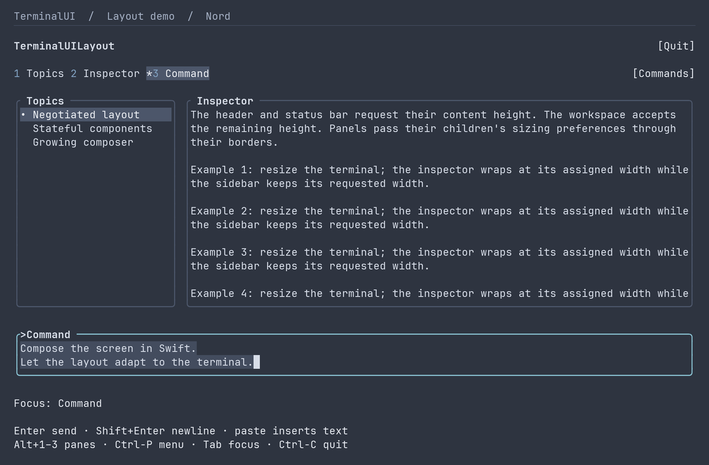

# Layout demo

A workspace built with the TerminalUI layout DSL: a fixed sidebar, a scrolling inspector, a growing command editor and searchable pane navigation.

```sh
swift run LayoutDemo
```



## Using the demo

| Input | Action |
| --- | --- |
| Alt+1 / Alt+2 / Alt+3 | Focus Topics, Inspector or Command. |
| Ctrl-P | Open the searchable command menu. |
| Escape | Close the menu and restore focus. |
| Tab | Move between controls. |
| Enter in Command | Submit and clear the draft. |
| Shift+Enter in Command | Insert a newline when the terminal reports the key distinctly. |
| Ctrl-C | Quit. |

Focus starts on Topics. Selecting a topic updates the inspector; moving between panes preserves the selection and command draft. Pasted multiline text stays in the editor without submitting.

Mouse clicks and wheel scrolling are enabled. Run `swift run LayoutDemo --no-mouse` to preserve normal terminal text selection. Control+1–3 also navigate when the terminal reports those combinations distinctly.

## Reading the code

`App/` contains the entry point and theme. `Support/` contains the reusable screen, model and views.

- [LayoutScreen](Support/Views/LayoutScreen.swift) composes the screen, opens the command menu and reads the focused pane.
- [WorkspaceView](Support/Views/WorkspaceView.swift) owns topic selection and shares it with the sidebar and inspector.
- [CommandPane](Support/Views/CommandPane.swift) owns the editor draft.
- [LayoutViewModel](Support/ViewModels/LayoutViewModel.swift) supplies topics, status and commands.

For the APIs used here, see [layout and sizing](../../Documentation/Layout.md) and [views, state and focus](../../Documentation/Components.md).
