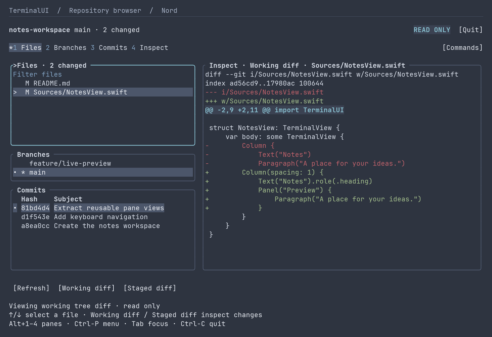

# Repository browser

A Git browser built from TerminalUI views, with file diffs, branch history and commit inspection.

```sh
swift run RepositoryDemo --repo /path/to/repository
```

Git must be available on `PATH`. Omit `--repo` to browse the current directory, or pass a directory inside a repository. Use `--help` for command-line options.



## Using the browser

Select a file to inspect its working diff; choose Staged diff for index changes. Select a branch to read its history without checking it out. Select a commit to see its message, metadata, file statistics and patch. Newer and Older step through the latest 50 commits on HEAD.

| Input | Action |
| --- | --- |
| Alt+1–4 | Focus Files, Branches, Commits or Inspect. |
| e | Open the selected file in an editor from the Files list. |
| Ctrl-P | Open repository commands. |
| Escape | Close the command menu or help dialog. |
| Tab | Move between controls. |
| Ctrl-C | Quit. |

Mouse input is enabled; use `--no-mouse` to preserve normal terminal text selection. Control+1–4 also navigate when reported distinctly by the terminal. Shortcuts and contextual hints remain visible in the screen.

Press `e` in the Files list or choose **Open selected file in editor** from the commands menu. The editor runs from the repository root in the same terminal. Closing it returns to the browser and refreshes the diff. The browser selects an editor with `git var GIT_EDITOR`, so it uses `GIT_EDITOR`, `core.editor`, `VISUAL` or `EDITOR` in that order, followed by Git's default. Configure an executable with any editor flags it needs, such as `GIT_EDITOR='vim -f'`. [Git editor configuration](https://git-scm.com/docs/git-var#Documentation/git-var.txt-GITEDITOR)

Refresh reloads external changes while preserving surviving selections. A successful refresh shows a banner for three seconds. If a refresh fails, the browser keeps the last loaded data and shows an error banner. Choose **Details** to open a compact dialog with **Retry** and **Dismiss**. Initial loading failures also offer **Retry**. Git queries performed by the browser are read-only.

The sidebar moves above the inspector below 85 columns. Resizing preserves the file filter, selection and focus.

## Reading the code

`App/` declares the entry point and typed options. `Support/` contains repository queries, shared state and pane views.

- [RepositoryScreen](Support/Views/RepositoryScreen.swift) handles loading, failure and retry.
- [RepositoryBrowser](Support/Views/RepositoryBrowser.swift) composes the screen and manages dialogs.
- [RepositoryWorkspace](Support/Views/RepositoryWorkspace.swift) adapts the pane arrangement to terminal size.
- [RepositoryViewModel](Support/ViewModels/RepositoryViewModel.swift) owns selections and inspection commands.
- [GitRepository](Support/Models/GitRepository.swift) performs read-only Git queries.

See [command-line arguments](../../Documentation/Arguments.md), [responsive layouts](../../Documentation/Layout.md#responsive-layouts) and [views, state and focus](../../Documentation/Components.md) for the framework APIs.
