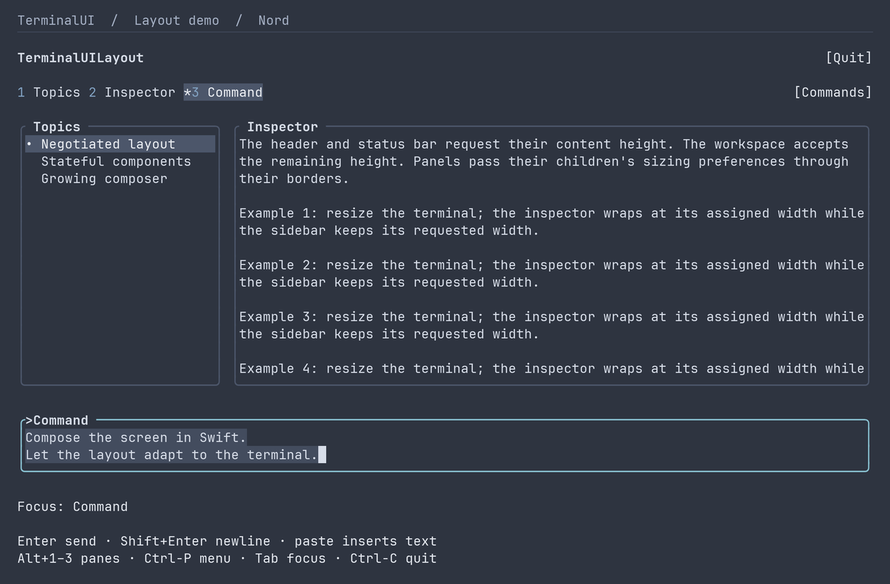
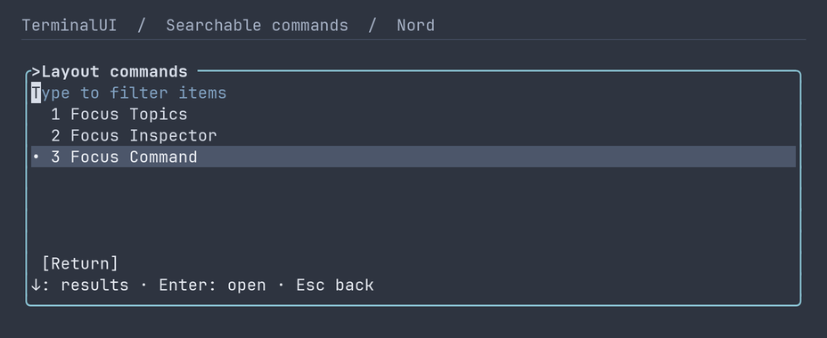
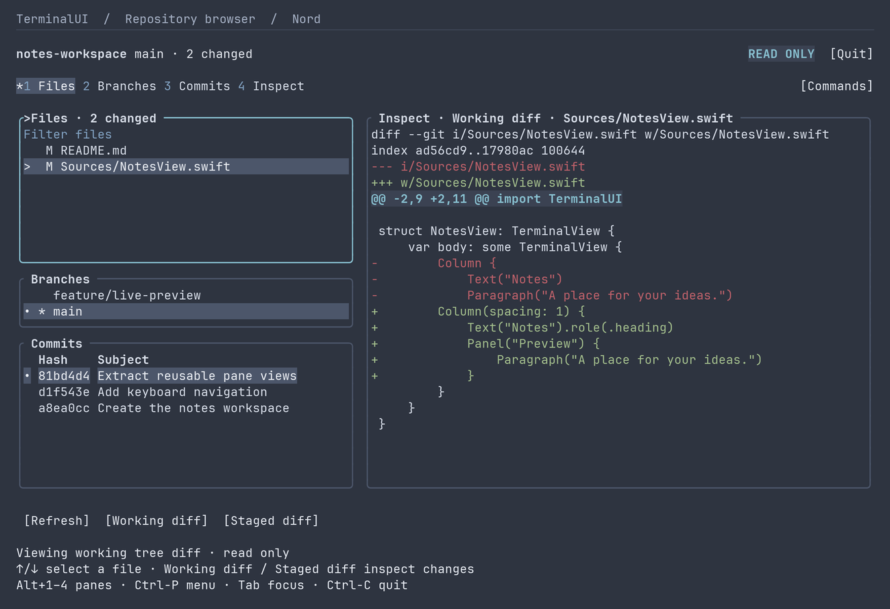

# TerminalUI

**Build terminal interfaces with a declarative Swift layout DSL.**

Compose screens from rows, columns, panels and interactive controls. Describe how content should fit, grow and align, bind controls to your state, and let TerminalUI handle layout and interaction as the terminal resizes.

- **Readable layouts.** Nest views to express the structure of your screen, with sizing and styling alongside the content they affect.
- **Flexible sizing.** Combine fixed sidebars, expanding workspaces and content that grows within a limit. Sizes and spacing use terminal cells.
- **Interactive by default.** Use text editors, lists, tables, menus and dialogs with keyboard navigation, scrolling and optional mouse support.
- **Reusable Swift views.** Extract components, share state and use ordinary Swift conditionals to build dynamic screens.



Requires **Swift 6.3**. Add the `TerminalUI` library product to your Swift Package Manager executable target. Interactive terminal support is tested on Linux.

## A small app, a complete screen

This notes app binds an editor to a live preview. The draft panel grows to eight rows, while the preview fills the remaining space and scrolls when needed.

```swift
import TerminalUI

@main
@TerminalApplication
struct NotesApp {
    var root: some TerminalView { NotesView() }
    var theme: Theme { .nord() }
}

@TerminalComponent
struct NotesView: TerminalView {
    @State private var draft = ""
    @ApplicationContext private var application

    var body: some TerminalView {
        Column(spacing: 1) {
            Row {
                Text("Notes").role(.heading)
                Spacer()
                Button("Quit").onActivate { application.stop() }
            }

            Panel("Draft") {
                TextEditor(id: "draft", text: $draft)
                    .initialFocus()
            }
            .height(.fit(maximum: 8))

            Panel("Preview") {
                ScrollView(id: "preview") {
                    Paragraph(draft.isEmpty ? "Your notes appear here." : draft)
                }
            }

            StatusBar("Tab: move focus · Shift+Enter: new line")
        }
    }
}
```

`@TerminalApplication` supplies the application entry point. `@TerminalComponent` connects local `@State` to the view; passing `$draft` to the editor keeps the preview in sync as you type.

## Layout that reads like your screen

Use `Column` for vertical sections and `Row` for side-by-side panes. Wrap related content in a `Panel`, add a `ScrollView` for longer content, and use `Spacer` to push controls apart.

```swift
Row(spacing: 1) {
    Panel("Navigation") {
        Column(spacing: 1) {
            Text("Overview").role(.heading)
            Text("Activity")
            Text("Settings")
        }
    }
    .width(.fixed(24))

    Panel("Workspace") {
        ScrollView(id: "workspace") {
            Paragraph("The workspace uses the remaining width and height.")
        }
    }
}
```

Most views choose a useful size automatically: text fits its content, while lists, tables and scroll views expand. Override sizing where the design calls for it:

| Intent | Modifier |
| --- | --- |
| Keep a sidebar 24 cells wide | `.width(.fixed(24))` |
| Let a panel grow up to eight rows | `.height(.fit(maximum: 8))` |
| Keep a list as tall as its content | `.height(.content)` |

Add padding, alignment and text styles where you need them. Layouts adjust to the available terminal space as the window resizes.

## From a screen to an application

Extract any part of a screen into a `TerminalView` with a `body: some TerminalView`. Keep local values in `@State` and use `@Binding` when views share editable data.

Add lists, tables, tabs or searchable menus as your application grows. Controls support keyboard navigation and callbacks for actions such as activating a button or submitting text.



Choose a built-in theme at the application level, as the example does with `.nord()`. Text roles such as `.heading` and `.secondary` keep styling consistent across the screen.

## Try it

From a checkout of this repository:

```sh
# Explore layouts and interactive controls.
swift run LayoutDemo

# Browse a Git repository.
swift run RepositoryDemo --repo /path/to/repository
```

The [layout demo](Examples/LayoutDemo/README.md) is a starting point for composing your own screen. The [repository browser](Examples/RepositoryDemo/README.md) shows how to organise a larger application into views and shared state.



## Learn more

- [Layout and sizing](Documentation/Layout.md)
- [Views, state, bindings and focus](Documentation/Components.md)
- [All guides](Documentation/README.md)

## Licence

TerminalUI is available under the [MIT licence](LICENSE).
